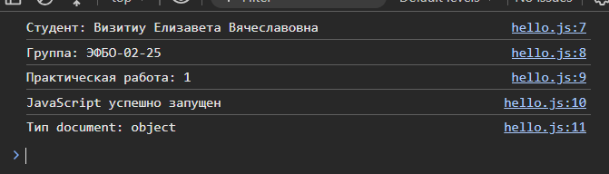
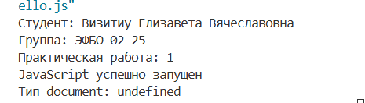
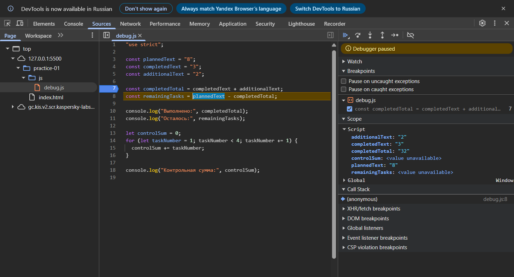

# Практическая работа №1

*Задание 1*
Запуск index.html в браузере. Вывод консоли:

Вывод в терминале:

## Вывод:
в ходе выполнения задания один и тот же JavaScript-файл был успешно запущен в двух средах: Node.js и браузере. Результат выполнения отличается в последней строке: в Node.js typeof document возвращает undefined, а в браузере — object. Это объясняется тем, что объект document доступен в браузере и представляет HTML-документ, но отсутствует в стандартной среде Node.js. Таким образом, результат выполнения JavaScript-кода может зависеть от среды его запуска.

*Задание 2*

Проверила выражения в Node.js.

| Выражение | Ожидание до запуска | Фактическое значение | Тип результата | Объяснение |
| --- | --- | --- | --- | --- |
| `"8" + 2` | `"82"` | `"82"` | `string` | Оператор `+` преобразует число в строку и объединяет операнды. |
| `"8" - 2` | `6` | `6` | `number` | При вычитании строка преобразуется в число. |
| `Number("8") + 2` | `10` | `10` | `number` | Сначала строка явно преобразуется в число, затем складываются два числа. |
| `"12" > "3"` | `false` | `false` | `boolean` | Строки сравниваются по символам. Первый символ `"1"` меньше `"3"`. |
| `12 === "12"` | `false` | `false` | `boolean` | Строгое равенство учитывает типы операндов. |
| `Number("")` | `0` | `0` | `number` | По правилам числового преобразования пустая строка даёт ноль. |
| `Number("text")` | `NaN` | `NaN` | `number` | Строку нельзя прочитать как число. `NaN` принадлежит типу `number`. |
| `Boolean("false")` | `true` | `true` | `boolean` | Любая непустая строка преобразуется в `true`. |
| `typeof null` | `"object"` | `"object"` | `string` | Историческая особенность JavaScript. Сам оператор `typeof` возвращает строку. |
| `typeof NaN` | `"number"` | `"number"` | `string` | Значение `NaN` относится к числам, а результат `typeof` имеет тип `string`. |

*Задание 3*

Для моего варианта (№ 4) выполнено 11 из 20 задач. Осталось 9, прогресс 55%.

| Всего, выполнено | Ожидание | Фактический результат | Итог |
| --- | --- | --- | --- |
| Вариант 4. `20, 11` | 9 осталось, 55.0%, В работе | Осталось: 9 Прогресс: 55.0% Статус: В работе | Пройдено |
| `12, 5` | 7 осталось, 41.7%, В работе | Осталось: 7 Прогресс: 41.7% Статус: В работе | Пройдено |
| `0, 0` | Задач пока нет | Задач пока нет | Пройдено |
| `5, 0` | 5 осталось, 0.0%, Не начато | Осталось: 5 Прогресс: 0.0% Статус: Не начато | Пройдено |
| `5, 5` | 0 осталось, 100.0%, Завершено | Осталось: 0 Прогресс: 100.0% Статус: Завершено | Пройдено |
| `5, 6` | Ошибка — выполнено больше общего числа | Ошибка: число выполненных задач должно быть целым числом от 0 до общего числа задач. | Пройдено |
| `-1, 0` | Ошибка — отрицательное общее число | Ошибка: общее число задач должно быть целым числом от 0 до 1000. | Пройдено |
| `5, 2.5` | Ошибка — дробное число выполненных задач | Ошибка: число выполненных задач должно быть целым числом от 0 до общего числа задач. | Пройдено |
| `"5", 2` | Ошибка — общее число передано строкой | Ошибка: общее число задач должно быть целым числом от 0 до 1000. | Пройдено |
| `1001, 0` | Ошибка — общее число выше 1000 | Ошибка: общее число задач должно быть целым числом от 0 до 1000. | Пройдено |
| `NaN, 0` | Ошибка — недопустимое общее число | Ошибка: общее число задач должно быть целым числом от 0 до 1000. | Пройдено |

*Задание 4*

В моём варианте нужно 2 дня. В первый день выполняется 6 задач, во второй — оставшиеся 3.

| Всего, выполнено, норма | Ожидание | Фактический результат | Итог |
| --- | --- | --- | --- |
| Вариант 4. `20, 11, 6` | 2 дня, выполнено по дням 6 и 3 | Осталось задач: 9 День 1: выполнено 6, осталось 3 День 2: выполнено 3, осталось 0 Потребуется дней: 2 | Пройдено |
| `12, 5, 3` | 3 дня, выполнено 3, 3 и 1 | Осталось задач: 7 День 1: выполнено 3, осталось 4 День 2: выполнено 3, осталось 1 День 3: выполнено 1, осталось 0 Потребуется дней: 3 | Пройдено |
| `10, 4, 3` | 2 дня, по 3 задачи | Осталось задач: 6 День 1: выполнено 3, осталось 3 День 2: выполнено 3, осталось 0 Потребуется дней: 2 | Пройдено |
| `5, 3, 10` | 1 день, выполнены 2 задачи | Осталось задач: 2 День 1: выполнено 2, осталось 0 Потребуется дней: 1 | Пройдено |
| `5, 5, 2` | 0 дней, цикл пропущен | Все задачи уже выполнены Потребуется дней: 0 | Пройдено |
| `0, 0, 2` | 0 дней, цикл пропущен | Все задачи уже выполнены Потребуется дней: 0 | Пройдено |
| `5, 2, 0` | Ошибка — нулевая норма | Ошибка: дневная норма должна быть целым числом от 1 до 1000. | Пройдено |
| `5, 2, 1.5` | Ошибка — дробная норма | Ошибка: дневная норма должна быть целым числом от 1 до 1000. | Пройдено |
| `5, 6, 2` | Ошибка — выполнено больше общего числа | Ошибка: число выполненных задач должно быть целым числом от 0 до общего числа задач. | Пройдено |
| `5, 2, "2"` | Ошибка — норма передана строкой | Ошибка: дневная норма должна быть целым числом от 1 до 1000. | Пройдено |
| `5, 2, 1001` | Ошибка — норма выше 1000 | Ошибка: дневная норма должна быть целым числом от 1 до 1000. | Пройдено |
| `0, 0, 0` | Ошибка — нулевая норма даже при отсутствии задач | Ошибка: дневная норма должна быть целым числом от 1 до 1000. | Пройдено |

*Задание 5*

Точка останова в DevTools:

| Что проверила | До исправления | Что изменила | После исправления |
| --- | --- | --- | --- |
| Выполненные и оставшиеся задачи | 32 выполнено, −24 осталось | Преобразовала строки через `Number()`, чтобы сложить числа 3 и 2. | 5 выполнено, 3 осталось |
| Контрольная сумма | 6 | Поменяла `< 4` на `<= 4`, чтобы цикл прибавил и четвёрку. | 10 |

## Вывод:

В этой работе я проверила, как JavaScript преобразует типы, и написала расчёт прогресса и план по дням. При отладке увидела, что из строк `"3"` и `"2"` получается `"32"`, поэтому перед сложением их нужно преобразовать в числа.
